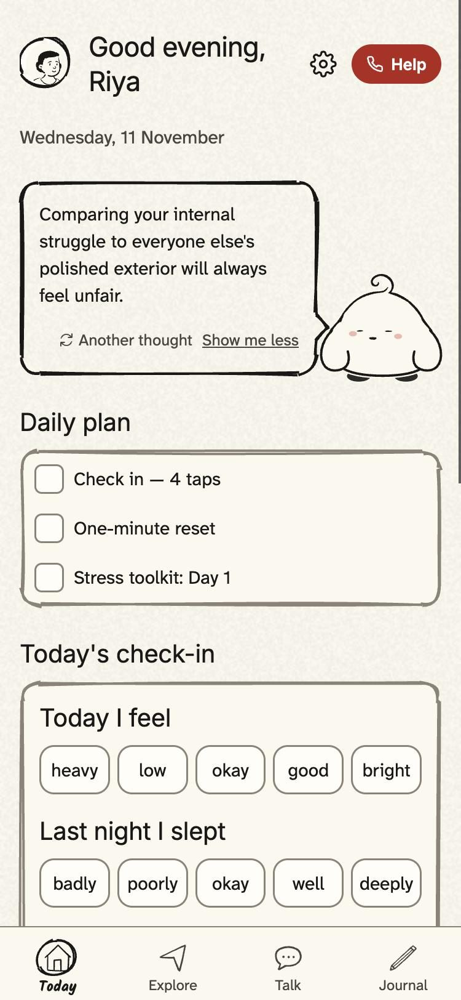
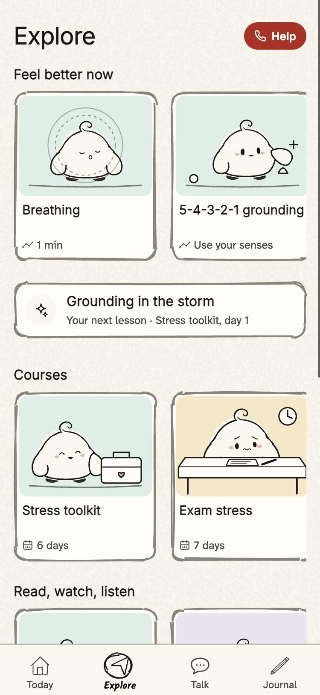
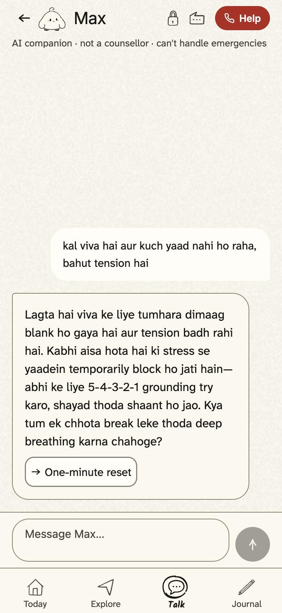

# MAX — Mental-health Assistance and eXpert

A free, private wellbeing companion for college students in India, built for a budget Android phone on 4G.

**Major Project E-G18** · Shri Vaishnav Institute of Information Technology, SVVV, Indore · Guide: Mr. Devendra Kuril
Prayagi Sahajwani · Sanskriti Kachole · Raja Jain · Rudraksh Mishra

MAX is **not** a doctor or a therapist. It never diagnoses, never talks about medicines, and never lets an AI handle a crisis.

| | |
| --- | --- |
| Android app | `com.eg18.max`, version in [`app.json`](app.json) |
| Web demo and API | <https://max-companion.expo.app> (EAS Hosting) |
| Website and college dashboard | <https://max-mental-health-expert.vercel.app> ([repo](https://github.com/RudrakshGit/M.A.X--Major-Project)) |

<p>
  
  
  
</p>

## What's inside

- **Today**: a four-tap check-in (mood, sleep, phone before bed, study pressure), a daily plan and a thought from MAX.
- **Explore**: breathing, grounding, thought reframe, spiral breaker, safety plan, short courses, quick reads, sounds and self-checks (PHQ-9, GAD-7 and more; a range, never a diagnosis).
- **Talk**: chat with MAX in English, Hinglish or Hindi. Crisis words show real helplines first; MAX then keeps checking in for a couple of replies.
- **Journal**: typed or spoken entries, feeling tags and an optional short reflection from MAX.
- **Help**: on every screen, even when the app is locked: 112, Tele-MANAS 14416, Vandrevala Foundation.
- **Settings**: name your companion, avatar, light/dark, reminders, app lock, screen time, Google backup, share stats with college, export or delete everything.

The **web build is a demo**: same screens, 20 chats a day, no reminders, voice, screen time, lock or backup.
**Colleges** register and see anonymous totals on the website; the app only sends numbers if the student adds a College ID.

## Privacy in short

Data lives on the phone. Chat text goes through our server to Groq (no training on API data) with emails and phone
numbers removed, and is not stored. Google backup and college sharing are opt-in; colleges only see totals from 10+
students. Details: [`docs/safety.md`](docs/safety.md).

## Quick start

```bash
npm install
cp .env.example .env.local   # add GROQ_API_KEY
npx expo start               # web: press w · phone: a dev build (see docs/setup.md)
```

```bash
npm run verify               # typecheck, tests, safety sets, repo rules
```

## Docs

| File | For |
| --- | --- |
| [`AGENTS.md`](AGENTS.md) | Rules that must not break (read before editing) |
| [`docs/setup.md`](docs/setup.md) | Run, build the APK, deploy the server and web demo |
| [`docs/architecture.md`](docs/architecture.md) | How the pieces fit, folders, data |
| [`docs/safety.md`](docs/safety.md) | Crisis layers, care mode, privacy boundary |
| [`docs/design.md`](docs/design.md) | Look, MAX the character, motion rules |
| [`docs/history.md`](docs/history.md) | Versions, milestones, owner decisions |
| [`PRODUCT.md`](PRODUCT.md) | Who it's for and what it promises |

## Stack

Expo SDK 57 (React Native 0.86, TypeScript) · Expo Router with API routes on EAS Hosting · Groq models · AsyncStorage
on the phone · Neon Postgres for backup and college totals · small Kotlin modules for screen time and the theme switch.
Everything runs on free tiers.

MIT licence ([`LICENSE`](LICENSE)); fonts, icons, avatars and sounds are credited in [`THIRD-PARTY.md`](THIRD-PARTY.md).
